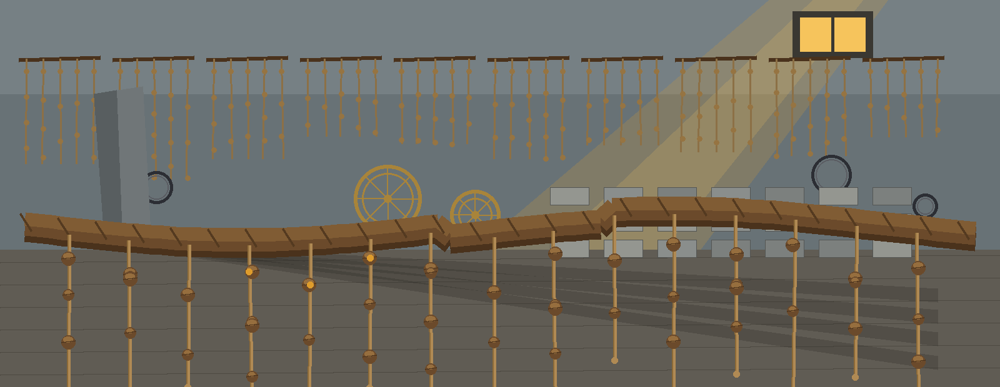
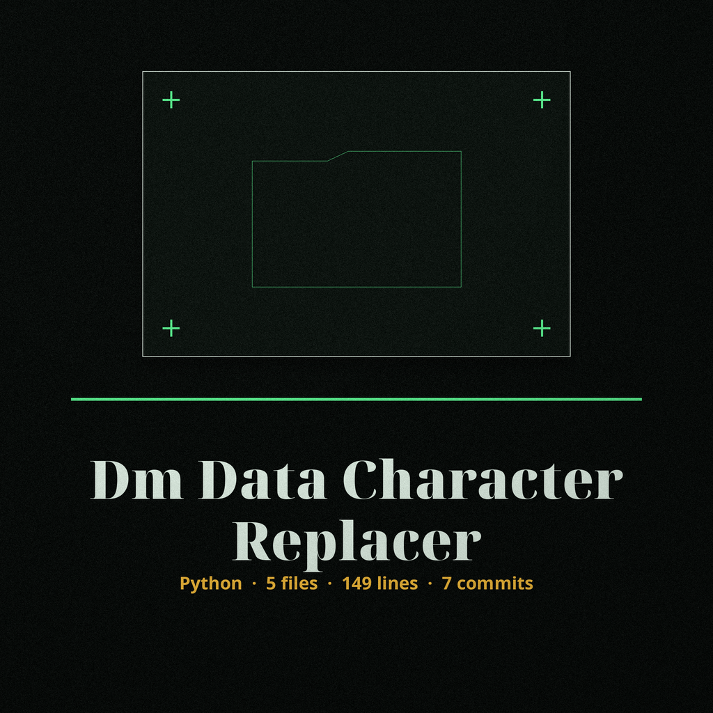
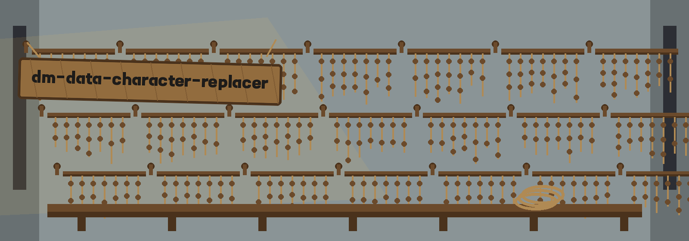

# dm-data-character-replacer

Title block: the name above is set in Tenada in iron on a sea grey plate, as a chronicle entry, counted in the season when the light comes in low through the high window, with a small seal image at the left of the block.

# dm-data-character-replacer
Replaces specific characters in data fields with a specified replacement character (e.g., replacing all digits in a phone number with 'X'). Provides options for targeted character sets and replacement strategies. - Focused on Tools designed to generate or mask sensitive data with realistic-looking but meaningless values

## Install
`git clone https://github.com/ShadowGuard-AI/dm-data-character-replacer`

## Usage
`python3 main.py INPUT_DATA [options]`

> Keeper note: global replacement is off unless its control is given, so a plain run touches the first match only.

## Parameters
- `input_data`: The input data string to process. Required.
- `-h`: Show help message and exit
- `-c`, `--characters`: The character set to replace (regular expression). Defaults to '\d' (digits).
- `-r`, `--replacement`: The replacement character. Defaults to 'X'.
- `-g`, `--global_replace`: Replace all occurences of the matching characters, otherwise only the first.
- `-i`, `--ignore_case`: Ignore case during character matching (useful for letters)
- `-v`, `--verbose`: Enable verbose logging.
- `-s`, `--security`: Enable secure processing that avoids printing the original input data if possible.

> Keeper note, corrected in this wave: the line above formerly ended after Defaults to and named nothing; the parser default is 'X', now filled in.

> Keeper note: secure mode promises avoidance only where possible. It is not printed as a guarantee, and this page does not dress it up as one.

## License
This project is released under the license in the [LICENSE](LICENSE) file. See LICENSE for details.

## Keeper notes gathered on the wall

The main button of this re-skin reads Replace the Chosen Characters. Its set field label reads Character Set, as a Regular Expression. Its replacement field label reads Replacement Character. Its headings read One Character In, One Character Out, First Match Unless Told Otherwise, and The Default the Source Leaves Blank. Closing: the spare coiled cord on the tally shelf is lifted and hung as a fresh record, empty of knots. The wall is full, the count is kept, and the next field of data has somewhere to go.
